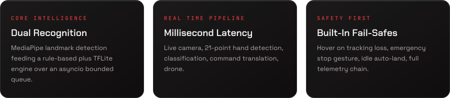
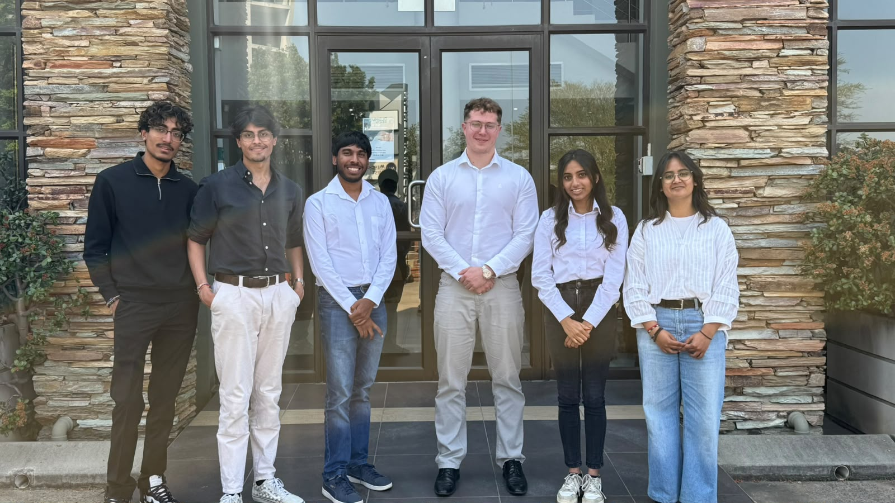
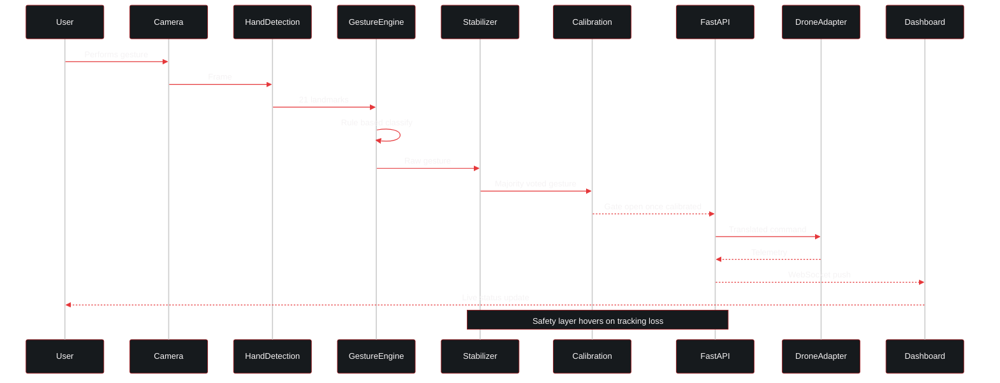
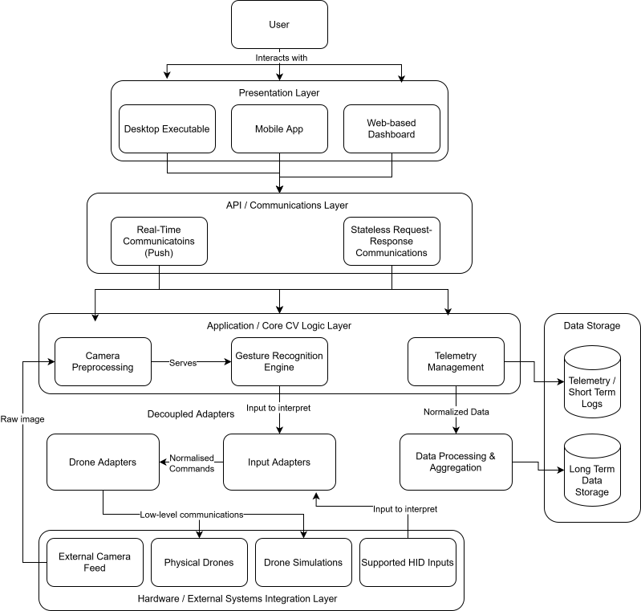
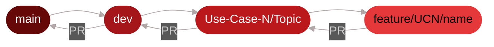

<div align="center">

<a href="#codex-merchants">
  
</a>

<a href="#codex-merchants">
  
</a>

<br/>

<a href="https://cos301-se-2026.github.io/Gesture-Based-Drone-Control/"></a>&nbsp;&nbsp;<a href="https://cos301-se-2026.github.io/Gesture-Based-Drone-Control/docs/"></a>&nbsp;&nbsp;<a href="https://www.youtube.com/@CodexMerchants"></a>

[](https://github.com/COS301-SE-2026/Gesture-Based-Drone-Control/actions/workflows/test.yml)
[](https://github.com/COS301-SE-2026/Gesture-Based-Drone-Control/actions/workflows/lint.yml)
[](https://github.com/COS301-SE-2026/Gesture-Based-Drone-Control/actions/workflows/docs.yml)
[](https://codecov.io/gh/COS301-SE-2026/Gesture-Based-Drone-Control)
[](https://github.com/COS301-SE-2026/Gesture-Based-Drone-Control/issues)
[](https://uptimerobot.com)

<br/>

[](https://cos301-se-2026.github.io/Gesture-Based-Drone-Control/docs/SRS/)
[](https://cos301-se-2026.github.io/Gesture-Based-Drone-Control/docs/SAS/)
[](https://cos301-se-2026.github.io/Gesture-Based-Drone-Control/docs/MANUAL/)
[](https://www.youtube.com/@CodexMerchants)
[](https://github.com/orgs/COS301-SE-2026/projects/70)
[](https://cos301-se-2026.github.io/Gesture-Based-Drone-Control/docs/BRAND/)
[](https://cos301-se-2026.github.io/Gesture-Based-Drone-Control/docs/api/API_REFERENCE/)
[](https://cos301-se-2026.github.io/Gesture-Based-Drone-Control/docs/testing/TESTING/)

<br/>

[](https://python.org)
[](https://fastapi.tiangolo.com)
[](https://mediapipe.dev)
[](https://react.dev)
[](https://vite.dev)
[](https://postgresql.org)
[](https://docs.astral.sh/uv/)
[](https://taskfile.dev)

</div>

<br/>

Control a drone with your hands. Our system uses real-time computer vision to recognize gestures and translate them into flight commands, with calibration and safety checks built in. Fly in a simulator, compete in gesture-controlled minigames, challenge yourself in testing environments, or switch to a keyboard, gamepad or on-screen controls. From learning the controls to practising flight, the project brings drone interaction into a more intuitive, accessible and interactive experience for pilots of all skill levels.

<br/>


Watch us take the app beyond just a simulator and fly a real drone: 
<p align="center">
  <a href="https://youtu.be/Zb7i9y775GM">
    
  </a>
</p>

<p align="center">
  <a href="https://youtu.be/Zb7i9y775GM"><strong>Watch the full flight</strong></a>
  &nbsp;·&nbsp;
  <a href="https://www.youtube.com/@CodexMerchants">Check out the Codex Merchants YouTube channel</a>
</p>

<div align="center">



</div>

<br/>


A live landing page **[landing page](https://cos301-se-2026.github.io/Gesture-Based-Drone-Control/)** serves as an easy place to get acquainted with the system and download the latest release.

The **[documentation hub](https://cos301-se-2026.github.io/Gesture-Based-Drone-Control/docs/)** hosts every deliverable. All documents also live in the repo under [`docs/`](docs/) as Markdown or PDF. 

### **Introduction**

<table>
  <tr>
    <th>Document</th>
    <th>Purpose</th>
  </tr>
  <tr>
    <td><a href="https://cos301-se-2026.github.io/Gesture-Based-Drone-Control/docs/MANUAL/"><b>User Manual</b></a></td>
    <td>Installation, calibration and introduction to gesture-based flight controls.</td>
  </tr>
  <tr>
    <td><a href="https://www.youtube.com/@CodexMerchants"><b>Demo Videos</b></a></td>
    <td>Recorded walkthroughs on the Codex Merchants YouTube channel.</td>
  </tr>
  <tr>
    <td><a href="https://cos301-se-2026.github.io/Gesture-Based-Drone-Control/docs/BRAND/"><b>Brand and Design System</b></a></td>
    <td>Visual identity, wireframes, colours and typography.</td>
  </tr>
</table>

### **Requirements and Design**

<table>
  <tr>
    <th>Document</th>
    <th>Purpose</th>
  </tr>
  <tr>
    <td><a href="https://cos301-se-2026.github.io/Gesture-Based-Drone-Control/docs/SRS/"><b>SRS</b></a></td>
    <td>Functional requirements, use cases, domain model and quality requirements.</td>
  </tr>
  <tr>
    <td><a href="https://cos301-se-2026.github.io/Gesture-Based-Drone-Control/docs/SAS/"><b>SAS</b></a></td>
    <td>Architectural patterns, services, design decisions and diagrams.</td>
  </tr>
  <tr>
    <td><a href="https://cos301-se-2026.github.io/Gesture-Based-Drone-Control/docs/frontend/atoms/"><b>Component Reference</b></a></td>
    <td>Frontend components, routing and service adapters.</td>
  </tr>
  <tr>
    <td><a href="https://cos301-se-2026.github.io/Gesture-Based-Drone-Control/docs/API_REFERENCE/"><b>API Reference</b></a></td>
    <td>REST and WebSocket contracts, schemas and examples.</td>
  </tr>
</table>

### **Development and Quality**

<table>
  <tr>
    <th>Document</th>
    <th>Purpose</th>
  </tr>
  <tr>
    <td><a href="https://cos301-se-2026.github.io/Gesture-Based-Drone-Control/docs/CODING/"><b>Coding Standards</b></a></td>
    <td>Code conventions, linting rules and review requirements.</td>
  </tr>
  <tr>
    <td><a href="https://cos301-se-2026.github.io/Gesture-Based-Drone-Control/docs/POLICY/"><b>Testing Policy</b></a></td>
    <td>Testing types, coverage targets and acceptance criteria.</td>
  </tr>
  <tr>
    <td><a href="https://cos301-se-2026.github.io/Gesture-Based-Drone-Control/docs/testing/TESTING/"><b>Testing Manual</b></a></td>
    <td>How to run the test suites and what they cover.</td>
  </tr>
  <tr>
    <td><a href="https://cos301-se-2026.github.io/Gesture-Based-Drone-Control/docs/nfr/NFR/"><b>NFR Verification</b></a></td>
    <td>Non-functional requirement evidence and traceability matrix.</td>
  </tr>
  <tr>
    <td><a href="https://cos301-se-2026.github.io/Gesture-Based-Drone-Control/docs/GIT/"><b>Git Conventions</b></a></td>
    <td>Branching, commit messages and pull request rules.</td>
  </tr>
  <tr>
    <td><a href="https://cos301-se-2026.github.io/Gesture-Based-Drone-Control/docs/CICD/"><b>CI/CD Pipeline</b></a></td>
    <td>GitHub Actions workflows and quality gates.</td>
  </tr>
</table>

### **Planning and Project Archives**

<table>
  <tr>
    <th>Document</th>
    <th>Purpose</th>
  </tr>
  <tr>
    <td><a href="https://cos301-se-2026.github.io/Gesture-Based-Drone-Control/docs/PLAN/"><b>Project Plan</b></a></td>
    <td>Roadmap, milestones and demo deliverables.</td>
  </tr>
  <tr>
    <td><a href="https://cos301-se-2026.github.io/Gesture-Based-Drone-Control/docs/demo/demo_one_documentation/"><b>Demo 1 Archive</b></a></td>
    <td>Archived deliverables from the first demonstration.</td>
  </tr>
  <tr>
    <td><a href="docs/reports/tender.pdf"><b>Tender Document</b></a></td>
    <td>Original proposal submitted to the client.</td>
  </tr>
  <tr>
    <td><a href="https://github.com/orgs/COS301-SE-2026/projects/70"><b>GitHub Project Board</b></a></td>
    <td>Live sprint board, backlog and work in progress.</td>
  </tr>
</table>

<br/>

<a id="the-team-codex-merchants"></a>


<p align="center">
  
  <br>
  <em>Left to right: Ayush, Shavir, Jaitin, Cameron (Project Mentor), Chinmayi, Diya</em>
</p>

<div align="center">

<br/>
<table>
<tr>
<td align="center" width="20%" valign="top">
<a href="https://github.com/Ayush-B99"></a><br><br>
<strong>Ayush Beekum</strong><br>
<sub><code>u23596351</code></sub><br>
<sub>Team Lead, Computer Vision</sub><br><br>
<a href="docs/cvs/ayush-beekum-cv.pdf"></a><br><br>
<sub><a href="https://github.com/Ayush-B99">GitHub</a> | <a href="https://www.linkedin.com/in/ayush-beekum-6423862b4/">LinkedIn</a></sub>
</td>
<td align="center" width="20%" valign="top">
<a href="https://github.com/ShavirV"></a><br><br>
<strong>Shavir Vallabh</strong><br>
<sub><code>u23718146</code></sub><br>
<sub>Backend, Game Dev, HID Integration</sub><br><br>
<a href="docs/cvs/shavir-vallabh-cv.pdf"></a><br><br>
<sub><a href="https://github.com/ShavirV">GitHub</a> | <a href="https://www.linkedin.com/in/shavir-vallabh-a0284026a/">LinkedIn</a></sub>
</td>
<td align="center" width="20%" valign="top">
<a href="https://github.com/Wave2055"></a><br><br>
<strong>Jaitin Moodally</strong><br>
<sub><code>u23621372</code></sub><br>
<sub>Systems, DevOps, Low-level</sub><br><br>
<a href="docs/cvs/jaitin-moodally-cv.pdf"></a><br><br>
<sub><a href="https://github.com/Wave2055">GitHub</a> | <a href="https://www.linkedin.com/in/jaitin-moodally/">LinkedIn</a></sub>
</td>
<td align="center" width="20%" valign="top">
<a href="https://github.com/deexglitch"></a><br><br>
<strong>Diya Narotam</strong><br>
<sub><code>u23533596</code></sub><br>
<sub>UI/UX, Data Analysis, Game Dev</sub><br><br>
<a href="docs/cvs/diya-narotam-cv.pdf"></a><br><br>
<sub><a href="https://github.com/deexglitch">GitHub</a> | <a href="https://www.linkedin.com/in/diya-narotam-062222412/">LinkedIn</a></sub>
</td>
<td align="center" width="20%" valign="top">
<a href="https://github.com/ChinmayiSanthosh"></a><br><br>
<strong>Chinmayi Santhosh</strong><br>
<sub><code>u24585671</code></sub><br>
<sub>Frontend, Testing, User Training</sub><br><br>
<a href="docs/cvs/chinmayi-santhosh-cv.pdf"></a><br><br>
<sub><a href="https://github.com/ChinmayiSanthosh">GitHub</a> | <a href="https://www.linkedin.com/in/chinmayi-santhosh-b53b09438">LinkedIn</a></sub>
</td>
</tr>
</table>
<br/>

<details>
<summary><b>Why each member is here, click to expand individual profiles.</b></summary>

<br/>

<table>
<tr><td>

#### Ayush Beekum - Team Lead

Has delivered production web applications for real clients using React and Python, demonstrating equal strength on both frontend and backend development. Completed several standalone projects from concept to deployment, including a Python system that fetches real-time data from an API and reflects it live in the application. Language proficiency: Python, JavaScript, TypeScript, SQL, C++, Java, PHP. Works across the entire proposed stack. Consistent integration owner and bug fix go-to.

</td></tr>
<tr><td>

#### Shavir Vallabh - Backend, HID integration, Systems Architecture

Strong Currently works part time in the University of Pretoria's Computer Science department on Linux infrastructure, cluster computing, and full-stack internal tools. Strong background in backend development, and architecting systems; with interests in applied AI, cybersecurity, HPC, and software engineering.

</td></tr>
<tr><td>

#### Jaitin Moodally - Systems, DevOps, Low Level

Experience across multiple operating systems and environments. Homelab veteran. Runs different applications on resource constrained VMs. Experienced hosting multi user applications and writing low level code. Top stack: Java, C++, C, Python, TypeScript. Interested in Cyber Security, Machine Learning, Artificial Intelligence and Devops. 

</td></tr>
<tr><td>

#### Diya Narotam - UI/UX and Frontend

Hands on with Python and NumPy for data manipulation. Strong OOP foundations in C++ and Java, proficient SQL. 1st place in a school website update hackathon. UI/UX contributor with PWA experience. Has built offline capable mobile applications. Testing across Playwright, Vitest and Jest gives solid grounding in both unit and end to end testing.

</td></tr>
<tr><td>

#### Chinmayi Santhosh - Frontend and Data

Considerable statistical and data analysis skills. UI engineering across React and Tailwind CSS. Writes unit and integration tests to ensure frontend reliability and catch regressions early. Consistent frontend contributor across every university project. Delivers clean, functional interfaces and collaborates well across the stack.

</td></tr>
</table>

</details>

<br/>

**Team Email:** [codexmerchants@gmail.com](mailto:codexmerchants@gmail.com)

</div>

<br/>


The full architecture, from raw camera input through to packaged desktop application and CI/CD automation, with all diagrams, lives in the **[Software Architecture Specification](https://cos301-se-2026.github.io/Gesture-Based-Drone-Control/docs/SAS/)**.

<details>
<summary><b>Gesture to Command sequence diagram. Click to expand.</b></summary>

<br/>



</details>

<details>
<summary><b>System architecture diagram. Click to expand.</b></summary>



</details>

<br/>

### Gesture vocabulary

The rule-based recognizer classifies six gestures from MediaPipe's 21 hand landmarks for each finger raised, plus an `UNKNOWN` failure state for low-confidence or unmatched frames. Per-frame classifications pass through the `GestureStabilizer`, which takes the majority vote from a sliding window of frames.

### Calibration gate

Before any flight command is accepted, the user walks the calibration sequence once. This is a safety net that proves the pipeline can read *this* user's hand under *this* lighting. 

The sequence runs through each gesture, proceeding once the system is confident that a gesture is sufficiently recognised

### Hardware Communication

The system allows for seamless integration of more HIDs (Human-Interface Devices) and drones through the use of a unique two-way adapter. Each HID inherits from an abstract `InputAdapter` class, and each drone inherits from an abstract `DroneAdapter` class. 

This means that adding a new input method or drone implementation requires only one new file; and every existing implementation on the other side of the adapter is automatically guaranteed to work with no further configuration.

### API interface

Everything is mounted under the `/api` prefix. Interactive Swagger docs are served at `/docs` when the backend is running.

<details>

<summary>Expand for a summary, or check out each API endpoint in the <a href=https://cos301-se-2026.github.io/Gesture-Based-Drone-Control/docs/api/SWAGGER/#/>Hosted Swagger Docs</a>.</summary> 

| Router | Endpoints |
|:---|:---|
| root | `GET /api/health` |
| `/auth` | `GET /health` · `POST /login` · `POST /signup` · `POST /refresh` · `POST /logout` · `GET /me` |
| `/drone` | `GET /health` · `POST /connect` · `POST /disconnect` · `GET /status` · `GET /feed` · `WS /ws/telemetry` · `WS /ws/commands` |
| `/gestures` | `GET /health` · `GET /status` · `WS /stream` · `GET /recognizer` · `POST /recognizer`|
| `/calibration` | `GET /status` · `POST /start` · `POST /skip` · `WS /stream` |
| `/input` | `POST /connect` · `POST /disconnect` · `GET /status` · `WS /ws/keyboard` · `WS /ws/gamepad` · `GET /gesture/events` · `POST /gesture/config` · `WS /ws/gesture/status` · `WS /ws/gesture/events`|
| `/analytics` | `GET /flights` · `GET /summary` |
| `/game` | `POST /connect` · `POST /disconnect` · `GET /status` · `WS ws/commands`|
| `/leaderboard` | `POST /scores` · `PATCH /scores/{entry_id}/name` · `GET /scores/{game_id}` |

</details>

<br/>


The project uses a monorepo structure that separates the frontend, backend, shared packages, and supporting services. 

It includes dedicated modules for computer vision, gesture recognition, drone control, input handling, telemetry, authentication, and database management. 

The repository also contains unit and integration tests, performance testing tools, project documentation, packaging configurations, and the library for Project AirSim, maintained as a submodule.

<details>
<summary><b> Click to see the actual project structure, as a tree of depth 3 </b></summary>

```
.
├── apps
│   ├── backend
│   │   ├── app
│   │   └── tests
│   └── frontend
│       ├── electron
│       ├── node_modules
│       ├── playwright-report
│       ├── public
│       ├── src
│       ├── test-results
│       └── tests
├── backend.egg-info
├── build
│   ├── GestureBasedDroneControl-Backend
│   ├── signalling
│   │   ├── Public
│   │   ├── modules
│   │   ├── node_modules
│   │   ├── platform_scripts
│   │   └── tps
│   └── sim
│       ├── Blocks
│       └── Engine
├── dist
├── docs
│   ├── api
│   ├── assets
│   │   └── readme
│   ├── contracts
│   ├── cvs
│   ├── demo
│   │   └── demo_one_documentation
│   ├── diagrams
│   ├── frontend
│   ├── hooks
│   ├── includes
│   ├── javascripts
│   ├── nfr
│   │   └── evidence
│   ├── reports
│   ├── services
│   ├── stylesheets
│   └── testing
├── init-db
├── landing_page
│   └── src
│       ├── assets
│       ├── components
│       ├── constants
│       ├── context
│       ├── hooks
│       └── lib
├── packages
│   ├── api-contracts
│   ├── contracts
│   │   ├── python
│   │   └── typescript
│   ├── domain
│   │   └── models
│   └── utils
├── packaging
├── services
│   ├── auth
│   ├── commands
│   ├── cv_pipeline
│   │   ├── camera
│   │   ├── gestures
│   │   ├── hand-detection
│   │   ├── hand_detection
│   │   └── processing
│   ├── database_manager
│   │   ├── managers
│   │   └── models
│   ├── drone_control
│   │   └── adapters
│   ├── drone_services.egg-info
│   ├── input
│   │   └── sources
│   ├── telemetry
│   │   └── storage
│   └── tests
│       ├── adapter_testing
│       ├── auth_testing
│       ├── cv_pipeline_testing
│       └── database_manager_testing
├── tests
│   ├── integration
│   │   ├── auth_testing
│   │   ├── db_manager_tests
│   │   └── gestures
│   └── nfr
│       ├── jmeter
│       └── lighthouse
└── vendors
    ├── projectairsim
    │   ├── build
    │   ├── docs
    │   ├── src
    │   └── tests
    └── sim_config

112 directories
```
</details>

<br/>


<div align="center">


</div>

<br/>

<details>
<summary><b>Computer Vision and Gesture Recognition</b></summary>
<br/>

| Technology | Purpose | Version |
|:---|:---|:---:|
|  | Primary language. CV, services, drone SDK integration | `3.11.x` |
|  | Live camera feed and image preprocessing | `4.8+` |
|  | Real time 21-point hand landmark detection and tracking | `0.10.21` |
|  | Vector math. Angles, distances, finger state | `1.26+` |
|  | Machine learning model training, gesture classification, and evaluation | `1.5+` |
| Rule Based Recognizer | Deterministic, zero latency gesture classification | `custom` |
| Gesture Stabilizer | Majority voting over a rolling buffer, kills single-frame noise | `custom` |
| ML Recognizer | Second engine behind the same `GestureRecognizer` ABC | `custom` |
| Asyncio & Bounded Queue | Non blocking real time pipeline, drops stale frames | `built-in` |

</details>

<details>
<summary><b>Drone Integration and Simulation</b></summary>
<br/>

| Adapter | Purpose | 
|:---|:---|
| `DroneAdapter` (ABC) | Common contract. Every backend talks the same interface | 
| `ProjectAirSimAdapter` | Unreal Engine 5 Project AirSim. Async native (pynng), body-frame velocity |
| `AirSimAdapter` | Legacy AirSim built in Unreal Engine 4. NED conversions handled in-adapter | 
| `DummyDroneAdapter` | In-memory drone for tests and CI. No simulator required | 
| `TelloAdapter` | Physical drone communication | 
| `GameAdapter` | Used for minigames and training | 

> Project AirSim is vendored as a git submodule (`vendors/`) so the client and `sim_config` stay pinned and reproducible. Clone with `--recurse-submodules`.

</details>

<details>
<summary><b>Input Sources</b></summary>
<br/>

| Adapter | Purpose |
|:---|:---|
| `InputAdapter` (ABC) | Common contract for every control surface |
| `GestureAdapter` | Hand gestures from the CV pipeline |
| `KeyboardAdapter` | Arrow keys, WASD, controls just like a PC game  |
| `GamepadAdapter` | Dual-stick support, triggers and face buttons; with full analog support |
| `DummyInputAdapter` | Deterministic input for tests |


</details>

<details>
<summary><b>Backend, Auth and Database</b></summary>
<br/>

| Technology | Purpose | Version |
|:---|:---|:---:|
|  | REST & WebSocket API (ASGI), Swagger at `/docs` | `0.136+` |
|  | Async ORM. Models and managers in `services/database_manager` | `2.0+` |
|  | Local database for users, telemetry and preferences using `aiosqlite` | `3.x` |
|  | Schemas, validation, settings (`pydantic-settings`) | `2.13+` |
| PyJWT & bcrypt | Access and refresh tokens, password hashing, HTTP-only cookies | `latest` |
|  | Unit, integration and API testing. `pytest-asyncio` in auto mode | `9.x` |

</details>

<details>
<summary><b>Frontend</b></summary>
<br/>

| Technology | Purpose | Version |
|:---|:---|:---:|
|  | Dashboard UI. Atomic design, JSX | `18` |
|  | Dev server and bundler | `8.x` |
|  | Utility first styling, light and dark themes | `3.x` |
| shadcn/ui & lucide-react | Component primitives and icon set | `latest` |
| React Router | Client routing under `RootLayout` | `7.x` |
| Recharts | Real time telemetry and analytics visualization | `3.x` |
| Leaflet & react-leaflet | GPS map view for simulated flight paths | `1.9 / 4.2` |
|  | Landing page, Playwright specs, shared contracts | `5.x+` |
|  | Both component-level unit tests and end to end tests | `1.60+` |

</details>

<details>
<summary><b>Packaging and Deployment</b></summary>
<br/>

| Technology | Purpose | Version |
|:---|:---|:---:|
|  | Freezes the backend, CV pipeline and simulator client into one binary | `6.21+` |
|  | Desktop shell. `electron-builder` produces `.exe` and `.AppImage` | `43.x` |
| GitHub Pages | Landing page at `/` and documentation hub at `/docs` | `gh-pages` |

</details>

<details>
<summary><b>DevOps, Tooling and Documentation</b></summary>
<br/>

| Technology | Purpose |
|:---|:---|
|  | Single root workspace resolves backend, services and vendored packages together |
|  | Cross platform task runner. Same commands on Windows, macOS, Linux |
|  | Python lint and format. Single quotes, tab indent, 100 col, `E/F/I/N` rules |
| ESLint & Prettier | TypeScript and JSX linting and formatting. `format:check` gates CI |
|  | Test, lint, docs deploy and release build pipelines |
|  | Coverage reporting. Separate `backend` and `services` flags, 80% target |
|  | Version control. Trunk based, Use Case branches, submodule for vendors |
| MkDocs Material | Documentation hub (`mkdocs.yml`), deployed alongside the landing page |
|  | Performance and load testing for backend APIs and services. Simulates concurrent users and measures response times and throughput |

</details>

<br/>


<details>

<summary>Expand to see a breakdown of all use cases. Every use case is associated with a long-lived branch and a slice of the Project Board. A comprehensive breakdown is available in the <a href=https://cos301-se-2026.github.io/Gesture-Based-Drone-Control/docs/SRS/>SRS</a>.</summary>

<table>
  <tr>
    <th align="center" width="70">ID</th>
    <th width="220">Use Case</th>
    <th>Description</th>
  </tr>
  <tr>
    <td align="center"><code>UC1</code></td>
    <td>Hand Tracking and Gesture Recognition</td>
    <td>Tracks hand landmarks from the camera feed, recognizes gestures and converts them into drone commands.</td>
  </tr>
  <tr>
    <td align="center"><code>UC2</code></td>
    <td>Dashboard and Telemetry</td>
    <td>Displays live drone telemetry, recent commands and charts, with updates delivered over WebSockets.</td>
  </tr>
  <tr>
    <td align="center"><code>UC3</code></td>
    <td>Simulator Support</td>
    <td>Switches between Project AirSim, legacy AirSim and a dummy drone through a common adapter interface.</td>
  </tr>
  <tr>
    <td align="center"><code>UC4</code></td>
    <td>Controller Support</td>
    <td>Supports gamepad input with fully analog dual-stick controls, a controller layout interface and keyboard controls as an alternative.</td>
  </tr>
  <tr>
    <td align="center"><code>UC5</code></td>
    <td>Telemetry Logging</td>
    <td>Records flight telemetry and summaries in SQLite for later retrieval and processing.</td>
  </tr>
  <tr>
    <td align="center"><code>UC6</code></td>
    <td>GPS Simulation</td>
    <td>Simulates drone position updates and displays movement on a Leaflet map, including displacement statistics.</td>
  </tr>
  <tr>
    <td align="center"><code>UC7</code></td>
    <td>Tutorial and Help</td>
    <td>Provides a gesture reference, an interactive onboarding tutorial and an in-app help page.</td>
  </tr>
  <tr>
    <td align="center"><code>UC8</code></td>
    <td>Gesture Calibration</td>
    <td>Guides users through calibration before flight, with backend state management and REST and WebSocket endpoints.</td>
  </tr>
  <tr>
  <td align="center"><code>Wow1</code></td>
  <td>Gesture-Controlled Minigames</td>
  <td>Includes three minigames with high-score tracking, support for all existing input methods and persistent leaderboards for project day competitions.</td>
</tr>
<tr>
  <td align="center"><code>Wow2</code></td>
  <td>Drone Licensing Practice</td>
  <td>Provides a Three.js environment for practising four challenges based on a real drone licence test, controlled using the existing gesture system.</td>
</tr>
<tr>
  <td align="center"><code>Wow3</code></td>
  <td>Motion-Based Gestures</td>
  <td>Offers an alternative to the standard gesture system, recognising dynamic hand movements and changes in distance to support more advanced controls.</td>
</tr>
  <tr>
    <td align="center"><code>Base</code></td>
    <td>Registration and Login</td>
    <td>Handles account registration and login using JWT access and refresh tokens stored through HTTP-only cookies. Includes light and dark themes.</td>
  </tr>
  <tr>
    <td align="center"><code>Base</code></td>
    <td>Landing Page and Documentation</td>
    <td>Provides a public landing page built with Three.js and a MkDocs documentation site, deployed through GitHub Pages.</td>
  </tr>
  <tr>
    <td align="center"><code>DevOps</code></td>
    <td>Infrastructure and Release Builds</td>
    <td>Uses uv and Task to manage development, GitHub Actions for CI/CD, Codecov for coverage reporting, and PyInstaller and Electron for packaging.</td>
  </tr>
</table>

</details>

<br/>


**Prerequisites**

[](https://python.org)
[](https://docs.astral.sh/uv/)
[](https://taskfile.dev)
[](https://nodejs.org)
[](https://yarnpkg.com)

<details>
<summary>Expand for comprehensive instructions to start developing</summary>

> This project uses [Taskfile](https://taskfile.dev/) as an OS agnostic alternative to Make. It's a really nice tool.

Note, **Python must be 3.11.** The workspace pins `>=3.11,<3.12` because MediaPipe and the AirSim clients have no wheels beyond it.

If uv is not installed, follow the official installation [instructions](https://docs.astral.sh/uv/getting-started/installation/).

```bash
brew install go-task              # macOS
sudo snap install task --classic  # Linux
winget install Task.Task          # Windows
```

<br/>

**Clone the repository**

```bash
git clone --recurse-submodules https://github.com/COS301-SE-2026/Gesture-Based-Drone-Control.git
cd Gesture-Based-Drone-Control
cp .env.example .env
```

If you already cloned the repository without its submodules, initialise them with:

```
git submodule update --init --recursive
```

<br/>

**Install Dependencies and Libraries**

```bash
task install
```

This creates a Python 3.11 virtual environment, installs the dependencies required by AirSim, synchronizes the Python workspace and installs the frontend dependencies with Yarn.

Configure the environment variables in .env before running the application. In particular, set the backend port and any simulator paths required by your setup.

<br/>

**Run the application locally**

```bash
task dev
```

This starts the FastAPI backend and the Vite frontend development server. The backend uses BACKENDPORT from the environment; the frontend runs from apps/frontend.

To run either component separately:

```
task backend-dev
task frontend-dev
```

The public landing page has its own development server:

```
task landing
```
<br/>

**Test**

```bash
task test           # everything: unit, integration, end to end
```

Or by layer:

```bash
task unit-test             # Frontend and backend unit tests
task backend-unit-test     # Backend and services tests
task frontend-unit-test    # Frontend unit tests
task integration-test      # Integration tests
task e2e-test              # End-to-end tests
```

<br/>

**Linting and formatting**

```bash
task lint    # Python linting, frontend linting and API contract validation
task fix     # Automatically fix supported Python and frontend formatting issues
```

<br/>

**Build the desktop app**

```bash
task build
```

The build stages the simulator and its Pixel Streaming signalling server, packages the backend with PyInstaller, and builds the Electron desktop application.

Simulator build requirements:

- Set SIM_SRC in .env to the simulator directory or archive used for staging.

- The simulator staging task supports Linux and macOS shell environments, as well as a separate Windows PowerShell script.

- The staged simulator must contain the expected Blocks project and Linux shipping binary where applicable. Check the platform-specific staging requirements before building.

To remove generated build output:

```
task clean
```

</details>

<br/>


We use the [GitHub Flow](https://docs.github.com/en/get-started/using-github/github-flow). `main` automatically builds and deploys an executable Full conventions in the [Git docs](https://cos301-se-2026.github.io/Gesture-Based-Drone-Control/docs/GIT/).



> **Keep your Use Case branch current.** Regularly merge `dev` into it to stay aligned and avoid large conflicts. Resolve all conflicts locally before opening a PR.

<br/>


Testing and lintling run on every pull request, and release builds the packaged app on every push to `main`.

<br/>

<table>
  <tr>
    <th width="160">Workflow</th><th width="150">Status</th><th>Trigger and jobs</th>
  </tr>
  <tr>
    <td><b>Testing</b><br/></td>
    <td><a href="https://github.com/COS301-SE-2026/Gesture-Based-Drone-Control/actions/workflows/test.yml"></a></td>
    <td>PRs into <code>dev</code>, <code>main</code>, <code>Use-Case**</code>. Backend unit, frontend unit, then integration, then E2E. Coverage uploaded to Codecov under <code>backend</code> and <code>services</code> flags</td>
  </tr>
  <tr>
    <td><b>Linting</b><br/></td>
    <td><a href="https://github.com/COS301-SE-2026/Gesture-Based-Drone-Control/actions/workflows/lint.yml"></a></td>
    <td>Every PR. Ruff over Python, ESLint & Prettier over the frontend. No style drift</td>
  </tr>
  <tr>
    <td><b>Docs</b><br/></td>
    <td><a href="https://github.com/COS301-SE-2026/Gesture-Based-Drone-Control/actions/workflows/docs.yml"></a></td>
    <td>Pushes to <code>main</code> or <code>dev</code> touching <code>docs/</code>, <code>landing_page/</code> or <code>mkdocs.yml</code>. Builds both, deploys landing page at <code>/</code> and MkDocs at <code>/docs</code></td>
  </tr>
  <tr>
    <td><b>Release</b><br/></td>
    <td><a href="https://github.com/COS301-SE-2026/Gesture-Based-Drone-Control/actions/workflows/release.yml"></a></td>
    <td>Pushes to <code>main</code>. Matrix build on Windows and Ubuntu, produces <code>.exe</code> and <code>.AppImage</code>, publishes a GitHub Release</td>
  </tr>
  <tr>
    <td><b>Coverage</b><br/></td>
    <td><a href="https://codecov.io/gh/COS301-SE-2026/Gesture-Based-Drone-Control"></a></td>
    <td>80% project and patch target, 1% threshold. Tests, <code>__init__.py</code>,  <code>vendors/</code> excluded</td>
  </tr>
  <tr>
    <td><b>Issues</b></td>
    <td><a href="https://github.com/COS301-SE-2026/Gesture-Based-Drone-Control/issues"></a></td>
    <td>Open issue count. Tracked on the <a href="https://github.com/orgs/COS301-SE-2026/projects/70">Project Board</a></td>
  </tr>
</table>

<br/>


| Role | Name | Email |
|:---|:---|:---|
| Project Owner | Bryan Janse Van Vuuren | [bryan.janse.van.vuuren@epiuse.com](mailto:bryan.janse.van.vuuren@epiuse.com) |
| Project Mentor | Cameron Taberer | [cameron.taberer@epiuse.com](mailto:cameron.taberer@epiuse.com) |
| Team | Codex Merchants | [codexmerchants@gmail.com](mailto:codexmerchants@gmail.com) |

<br/>

<div align="center">



<br/><br/>


</div>